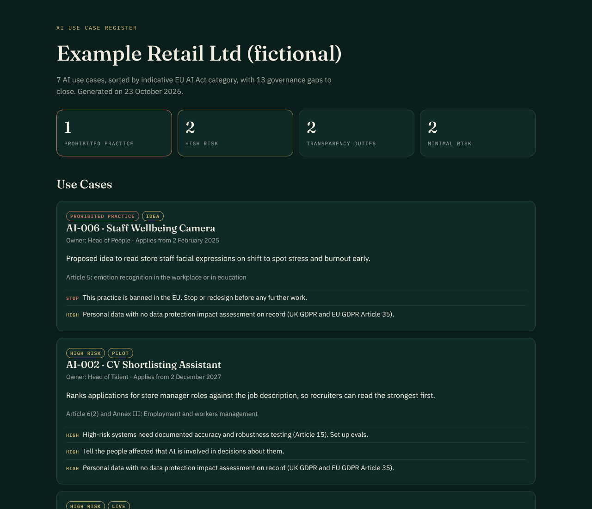

<p align="center"></p>

# AI Use Case Register

[](https://github.com/elleanderson/ai-use-case-register/actions/workflows/register.yml)


**[Open the sample report](https://elleanderson.github.io/ai-use-case-register/)**

A simple, version-controlled register of every AI use case in an organisation. Each one is checked against a schema, sorted into an indicative EU AI Act category and checked for the governance gaps that tend to bite later.



## Why This Exists

The first question a regulator, an auditor or a new board member asks about AI is the simplest one. Where are we actually using it? Most organisations can't answer quickly, because AI arrives through a dozen doors at once. A vendor feature is switched on here, HR runs a pilot there and marketing tries an image tool.

A register fixes that, but only if people keep it up to date. So this one lives where change already happens, in version control. Each use case is a short YAML file a product owner can fill in without a lawyer. Every change is reviewed, validated and triaged automatically. Every Monday the report rebuilds itself, so an overdue review shows up without anyone remembering to look.

## What It Does

- **A schema for a good entry.** `schema/use-case.schema.json` asks the questions that matter. Who owns it and who does it affect? Does it assist, recommend or decide? What data does it touch, who checks its work, does it have evals and are people told?
- **An indicative EU AI Act triage.** Each use case is sorted into one of four categories, with the article it rests on and the date its duties apply.
- **Governance gap checks.** It flags automated decisions without meaningful oversight, personal data without an impact assessment, live features with no evals, eval results below target, missing transparency and overdue reviews.
- **A report people will read.** A Markdown summary for pull requests and a clean HTML report, published to GitHub Pages.

### The Four Categories

| Category | When It Applies | Duties From |
|---|---|---|
| Prohibited Practice | Article 5 practices, such as emotion recognition at work or social scoring | 2 February 2025 |
| High Risk | Annex III areas, such as employment, credit, insurance and education | 2 December 2027 |
| High Risk (Products) | AI that is a safety component of a regulated product | 2 August 2028 |
| Transparency Duties | Chatbots, synthetic media, deepfakes and emotion recognition (Article 50) | 2 August 2026 |
| Minimal Risk | Everything else, where AI literacy and good practice still apply | 2 February 2025 |

The dates follow the AI Act as amended by the Digital Omnibus, Regulation (EU) 2026/1744, which moved the Annex III high-risk duties from August 2026 to December 2027.

## The Sample Register

The `register/` folder holds seven use cases for a fictional retailer and card lender. They show the full range. There's a well-run product description writer with no gaps, a customer chatbot and a credit model making automated decisions. There's also a CV shortlisting pilot and an idea for staff "wellbeing" cameras that the Act bans outright.

```yaml
id: AI-002
name: CV Shortlisting Assistant
owner: Head of Talent
purpose: Ranks applications for store manager roles against the job description, so recruiters can read the strongest first.
status: pilot
users: [job-applicants, staff]
decision_role: recommends
domain: employment
human_oversight: {level: every-output, reviewer: Recruiters}
evals: {in_place: false}
transparency: {people_told: false}
```

## Getting Started

You'll need Python 3.10 or later.

```bash
git clone https://github.com/elleanderson/ai-use-case-register.git
cd ai-use-case-register
pip install -e ".[dev]"

aireg validate register                     # check every entry against the schema
aireg report register --out site            # triage, then write site/index.html and site/register.md
aireg report register --fail-on high        # fail the build on any high or stop gap
```

To use it for your own organisation, delete the sample files, add your own and set `--org` to your organisation's name.

## Continuous Integration

The workflow in `.github/workflows/register.yml` runs on every pull request and every Monday morning. It runs the tests, validates the register, builds the report, adds it to the run summary and publishes it to GitHub Pages. A new use case can't be merged without a valid entry, and the weekly run surfaces overdue reviews on its own.

## How It's Built

- **Python**, with a small command-line tool, `aireg`
- **JSON Schema 2020-12**, validated with `jsonschema`, including date formats and unique IDs
- **YAML** entries that non-engineers can read and edit
- **pytest**, covering the schema, every category, the gap checks and the command-line tool
- **GitHub Actions and GitHub Pages**, for checks, a scheduled run and the published report

## A Note on the Law

This is an indicative triage to help teams see where to look first. It is not legal advice. The Act has exemptions and edge cases, such as the Article 6(3) exemption for narrow preparatory tasks, that need someone qualified to read the use case against the text. The tool says so where it matters, and it suggests recording your reasoning.

## About Me

I'm [Elle Anderson](https://andersonco.uk), a product leader and executive coach (Fellow, Chartered Institute for IT). I help senior teams adopt AI with the evidence, guardrails and economics to back it. If you'd like help setting up an AI register or governance for your own organisation, you can [book a consultation](https://andersonco.uk/book).

You might also like my [AI Glossary for Product Leaders](https://andersonco.uk/ai-glossary) and [AI Coach Evals](https://github.com/elleanderson/ai-coach-evals).

## Licence

MIT. Use it, adapt it and build on it.
